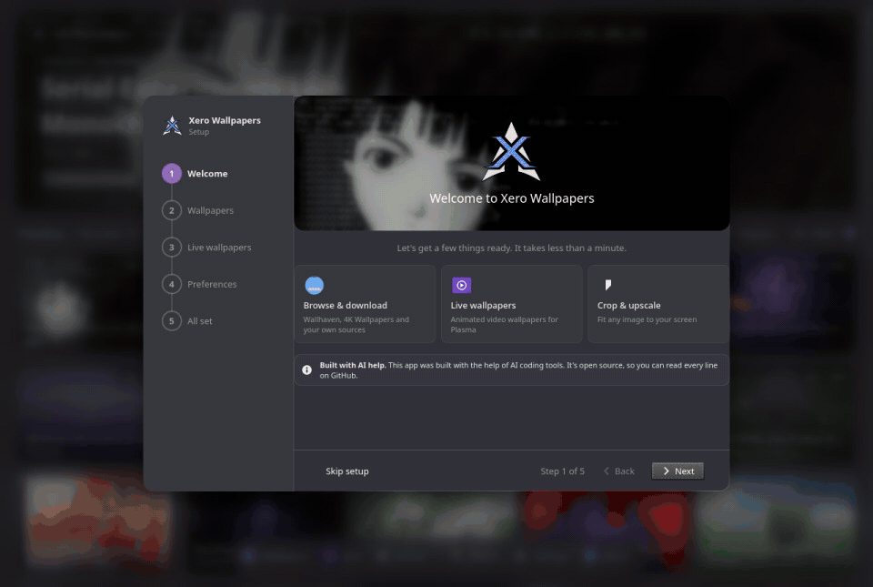

<p align="center">
  
</p>

<h1 align="center">Xero Wallpapers</h1>

<p align="center">
  
</p>

Xero Wallpapers is a KDE Plasma app for finding, previewing and setting wallpapers. Browse Wallhaven and 4K Wallpapers (plus MoeWalls and MotionBGs for live wallpapers), filter by tags, colour, resolution and aspect ratio, flip through results in a fullscreen coverflow, crop and upscale images, and keep everything in a local library. On Plasma it can also rotate your wallpapers with its own slideshow plugin and play live wallpapers through Smart Video Wallpaper Reborn. It is built with PyQt6, QML and Kirigami, and is always dark: it follows your Plasma colour scheme when it's dark; light schemes are replaced by Layan.

## Install on XeroLinux

```bash
sudo pacman -S xero-wallpaper-browser
```

## Other distros

**AppImage**: download `Xero_Wallpapers-<version>-<arch>.AppImage` (x86_64 or aarch64) from [Releases](https://github.com/xerolinux/xero-wallpapers-gui/releases), make it executable and run it. It updates itself: when a newer release is out, an "Update to <version>" button appears at the top right, and the app restarts on the new version. Browsing, downloading, editing and the library work on any desktop. Live wallpapers, the slideshow plugin and Smart Video Wallpaper Reborn need KDE Plasma; the app installs both plugins for your user, no extra system tools needed.

To [run from source](#run-from-source) instead, install the dependencies first.

**Fedora**

```bash
sudo dnf install python3-pyqt6 qt6-qtdeclarative qt6-qtmultimedia qt6-qtimageformats kf6-kirigami kf6-qqc2-desktop-style breeze-icon-theme python3-requests python3-beautifulsoup4 python3-pillow
```

**openSUSE Tumbleweed**

```bash
sudo zypper install python3-PyQt6 qt6-declarative-imports qt6-multimedia-imports qt6-imageformats kf6-kirigami-imports kf6-qqc2-desktop-style kf6-breeze-icons python3-requests python3-beautifulsoup4 python3-Pillow
```

**Debian 13 / Ubuntu 25.04 and newer**

```bash
sudo apt install python3-pyqt6 python3-pyqt6.qtqml python3-pyqt6.qtquick qml6-module-qtquick qml6-module-qtquick-controls qml6-module-qtquick-layouts qml6-module-qtquick-dialogs qml6-module-qtquick-effects qml6-module-qtquick-templates qml6-module-qtqml-workerscript qml6-module-qtmultimedia qml6-module-qt-labs-folderlistmodel qml6-module-org-kde-kirigami qml6-module-org-kde-desktop qt6-image-formats-plugins breeze-icon-theme python3-requests python3-bs4 python3-pil
```

Optional on every distro: `vulkan-tools` (finds a dedicated GPU for AI upscaling).

## Credits

The bundled fallback colour scheme `xero_wallpapers/data/Layan.colors` is from [Layan](https://github.com/vinceliuice/Layan-kde) by vinceliuice (GPL-3.0).

## License

[GPL-3.0](LICENSE)
